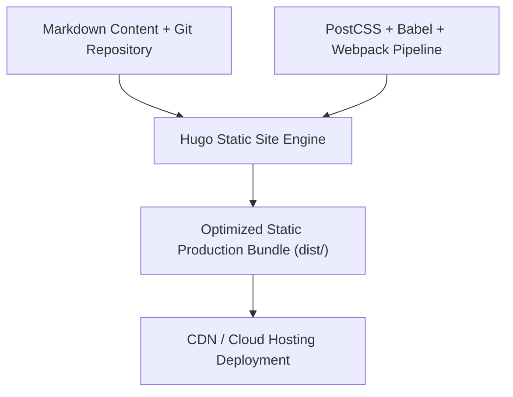

# Hugo template for Decap CMS with Netlify Identity


> **Author & Architect:** [Robina Mirbahar](https://github.com/RobinaMirbahar) (Google Developer Expert in Cloud & AI)  
> **Focus:** Fast Jamstack Documentation & Technical Blog Starter Powered by Hugo, Decap CMS & Automated CI/CD

---

## 🎯 Why I Built One-Click Hugo Static Site & Decap CMS Starter (Engineering Purpose & Real-World Value)

### 1. ⚡ Sub-Second Technical Publishing with Git-Backed CMS
I customized this Hugo + Decap CMS starter to provide a fast, Git-backed publishing workflow where every article, documentation page, and asset is version-controlled in Git.

### 2. 🛠️ Modern Asset Pipeline (PostCSS, Babel & Webpack)
Combines Hugo's ultra-fast Go template engine with a modern ES6/PostCSS asset pipeline for clean typography and responsive layouts.

### 3. ☁️ Deployable Anywhere
Builds into static HTML/CSS/JS bundles that can be hosted on Firebase Hosting, Google Cloud Run, or GitHub Pages.

---

## 🏗️ System Architecture



---

This is a small business template built with [Hugo](https://gohugo.io) and [Decap CMS](https://github.com/decaporg/decap-cms), designed and developed by [Darin Dimitroff](https://twitter.com/deezel), [spacefarm.digital](https://www.spacefarm.digital).

## Getting started

Use our deploy button to get your own copy of the repository. 

[](https://app.netlify.com/start/deploy?repository=https://github.com/decaporg/one-click-hugo-cms&stack=cms)

This will setup everything needed for running the CMS:

* A new repository in your GitHub account with the code
* Full Continuous Deployment to Netlify's global CDN network
* Control users and access with Netlify Identity
* Manage content with Decap CMS

Once the initial build finishes, you can invite yourself as a user. Go to the Identity tab in your new site, click "Invite" and send yourself an invite.

Now you're all set, and you can start editing content!

## Local Development

Clone this repository, and run `yarn` or `npm install` from the new folder to install all required dependencies.

Then start the development server with `yarn start` or `npm start`.

## Testing

With the development server running, run the tests locally
with `yarn cypress:run` or `npm run cypress:run`.
Or use `yarn cypress:open` or `npm run cypress:open` to run interactively.

Cypress tests also run on deploy with the [Cypress Netlify integration](https://www.netlify.com/integrations/cypress/).

## Layouts

The template is based on small, content-agnostic partials that can be mixed and matched. The pre-built pages showcase just a few of the possible combinations. Refer to the `site/layouts/partials` folder for all available partials.

Use Hugo’s `dict` functionality to feed content into partials and avoid repeating yourself and creating discrepancies.

## CSS

The template uses a custom fork of Tachyons and PostCSS with cssnext and cssnano. To customize the template for your brand, refer to `src/css/imports/_variables.css` where most of the important global variables like colors and spacing are stored.

## SVG Social Icons

The social media icons are in `site/assets/img`.
Make sure you use consistent icons in terms of viewport and art direction for optimal results.
For an icon named `icons-facebook.svg`, refer to the SVG `social-icon` partial like so:

```
{{ partial "social-icon" (dict "link" "#" "svg" "icons-facebook" "alt" "Kaldi on Facebook") }}
```

<!-- AUTHOR_SIGNATURE_START -->
---

## 👩‍💻 About the Author

**Robina Mirbahar — Google Cloud & AI Architect**  
*Google Developer Expert (GDE) in Cloud & AI • Published Author • Multi-Agent Systems & Serverless GPU Builder*

[](https://github.com/RobinaMirbahar)
[](https://medium.com/@robinamirbahar)
[](https://dev.to/robinamirbahar)
[](https://www.linkedin.com/in/robina-mirbahar)
[](https://g.dev/RobinaMirbahar)
[](https://www.youtube.com/@RobinaMirbahar)
[](https://x.com/RobinaMirbahar)
[](https://www.amazon.com/dp/B0D146249R)

<!-- AUTHOR_SIGNATURE_END -->
